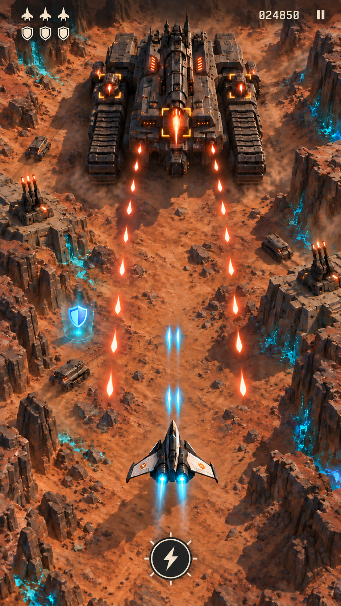
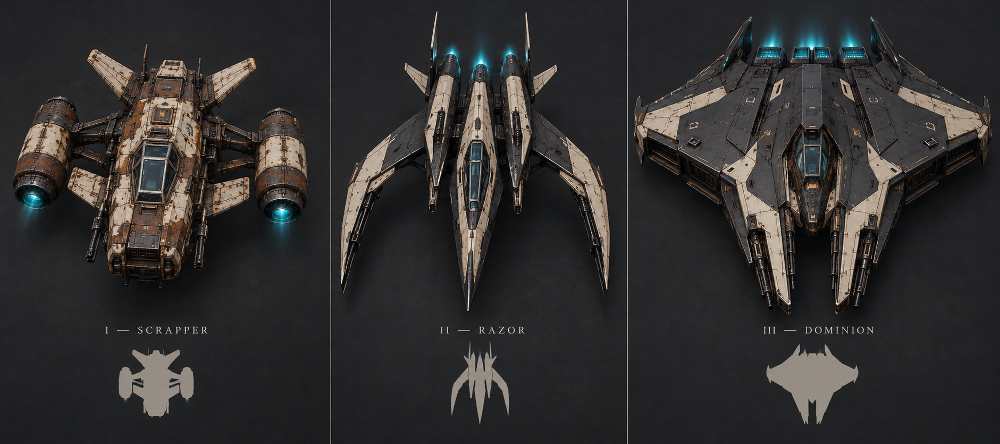

# Last Worlds — design for review

**Consolidated concept v0.3 · 13 October 2026.** Working title. This is the current design and build brief, incorporating our decisions so far. An initial flight prototype is now being implemented; see the build-status document for measured progress. Names, balance numbers, unlock thresholds, and exact dimensions remain proposals you can adjust; the core preferences you specified are recorded separately in the [decision log](docs/08-decisions-and-sources.md).

## The game

A fighter spacecraft flies continuously forward over alien planets. Real 3D terrain, vehicles, aircraft, and enormous mobile fortresses provide depth; combat stays on one plane. The camera looks down from behind in a modern isometric-inspired view. The style is mature and stylized: convincing materials and strong shapes, neither photorealistic nor toy-like.

You move left/right to line up shots, avoid enemy fire, and explore a wider map. The main weapon fires automatically when a valid target enters its firing path. One dedicated special attack provides a deliberate tactical action. Ground targets have clear screen-aligned weakpoints so elevation never makes aiming mysterious.

The game runs in a phone browser and is planned as an installable, offline-capable home-screen web app. Desktop keyboard controls are also supported. Native app-store packaging is outside the initial scope.

## Controls and minimal UI

- Hold the left screen half to move left; hold the right half to move right. No default drag steering, joystick, vertical movement, or main-fire button.
- Tap one **plain special button at bottom center**. It owns its touch separately from steering.
- Three small ship silhouettes show lives on Standard settings; simple shield glyphs show remaining protection. No hull health, shield bar, ammo meter, reactor gauge, or separate energy bar.
- Special recharge uses a few marks around its button. Endless score and pause remain small and readable.
- Left/right hints blink gently for the first three seconds of a new flight, then disappear. Reduced-motion uses a static temporary hint. No permanent arrows.

The UI should feel almost analog: flat ivory symbols, restrained outlines, ample space, clear typography. No shiny metal housing, neon trim, layered ability widgets, or reward-shop styling.

This image establishes interface placement. Its earlier hero silhouette will be replaced by the accepted tier designs below.

## Lives, shields, weapons

Proposed protection model: a normal hit consumes one shield icon; a heavy hit consumes two. A shield-breaking hit protects the current life, and the next accepted hit without shields costs a life. Short invulnerability prevents several overlapping bullets from immediately stripping multiple lives. Shields recover only through rare pickups, with no passive regeneration. The training sortie offers two cells on Relaxed/Standard and one on Veteran; endless offers one per sector. Each restores one charge. There is no hidden hull-health resource.

The main gun has unlimited ammunition. The special stores one activation and recharges through time, with a proposed small boost from eligible main-gun kills. It must remain useful when the player avoids optional targets. Special kills do not recharge themselves. Exact rates are in the [combat specification](docs/02-combat-and-progression.md).

## A world wider than the screen

The viewport is a slice of a larger map. Initial proposal: 36-unit-square terrain sections connected forward, with 12 units visible horizontally. You start near the middle; the camera follows when you travel beyond a central dead zone. Screen edges are not world walls.

Side routes contain optional fights, caches, and landmarks. You choose where to fly while automatic forward travel continues. Camera movement must preserve enemy damage, loot, and discovered-object state; moving away and returning cannot respawn rewards. Enemies outside view need readable warnings before threatening you. No permanent minimap is required initially.

This wider traversal belongs in the first prototype because it affects aiming, encounters, difficulty, and exploration. [Detailed camera/world rules](docs/10-wide-map-and-camera.md).

## Campaign: build, advance, replay

Campaign equipment has exactly four slots:

| Slot | Choices and purpose |
| --- | --- |
| Main weapon | Straight Pulse, fixed fan, piercing rail, or a homing family |
| Special weapon | Defensive Shockwave, guided Seeker Rack, or focused Siege Lance |
| Shield technology | Balanced protection, larger/slower reserve, or smaller/faster recovery |
| Reactor technology | Balanced handling, faster traversal, or precise acceleration/braking |

All owned combinations are legal. There is no equipment power budget or passive-module layer. Credits buy equipment and capped main-weapon improvements; changing owned gear is free. Campaign drops are coins and shield cells, not weapon replacements. Grinding funds experimentation, but the base campaign should remain clearable with skill and starter equipment.

Choose a difficulty before each mission: **Relaxed, Standard, or Veteran** are the proposed names. Relaxed offers more lives and gentler threats; Veteran increases challenge while retaining fair warnings and escape paths. Story progression is shared across campaign difficulties; mission records identify the setting. Small repeatable-income multipliers reward challenge, and first-clear rewards cannot be claimed again by changing difficulty. [Difficulty details](docs/11-campaign-difficulty.md).

Campaign-only advancement has two forms:

- **Career milestones:** cumulative goals such as destroying 100 aircraft or completing five missions. Named milestones pay credits once.
- **Optional mission contracts:** complete a mission without losing a life, destroy a target proportion of aircraft, or another compatible condition. Successful contracts can pay credits on replay.

These goals **only observe normal gameplay**. They never change auto-fire, damage, enemy behavior, drops, or camera movement. Sparing infrastructure is an example to consider only where existing content makes it feasible. A failed optional goal does not fail the main mission. [Objectives and statistics](docs/09-objectives-and-statistics.md).

## Endless: equal starts, increasing challenge

Every player starts with the same small fighter, Pulse, ready Shockwave, Standard shield, Balanced reactor, and three lives. Campaign purchases, difficulty, cosmetics, milestones, and time played cannot improve that start or change endless drop pools, routes, or scoring. Endless does not award campaign credits or advance campaign side missions.

Weapons become extravagant through run-only drops and sector choices. Equipment resets when the run ends. Shield/reactor stay at their standard technology in this version; main and special can change within the run.

**Difficulty ramps as sectors advance.** Initial sectors introduce patterns; later sectors combine stronger enemies and coordinated attacks, with a boss every third sector. HP, bullet speed, and threat budgets increase within fairness limits, then stay capped while encounter order and planets continue rotating. The run has no scripted final stage, but it never relies on infinitely fast unavoidable shots. Proposed sectors last 90 active seconds with short upgrade choices between them.

Records use one standardized endless ruleset, with versions and altered/practice categories kept separate. The MVP has local high scores; a public verified scoreboard is a later delivery decision. Random runs have equal starting conditions but still vary by seed; shared-seed challenges are an optional later comparison mode.

## Hero and alien designs

The accepted hero designs are **fundamentally different airframes**:

1. **Scrapper:** cheap, rusty utility fighter with bolt-on equipment; visibly smaller in gameplay.
2. **Razor:** sharp, agile split-body interceptor.
3. **Dominion:** broad advanced assault craft with integrated weapons and engines.

The equal-sized presentation on this board is for inspection. Initial in-game width targets are 1.0, 1.35, and 1.7 world units respectively. Cosmetic appearance never adds hidden stats or a smaller hitbox. Campaign appearance gates and any run-local endless evolution are separate; everyone begins endless with Scrapper.

The alien boards include six planet-faction craft and three more exotic concepts: **Orrery**, **Shard**, and **Veil**. The latest designs are accepted; no regeneration is needed. See the [complete concept gallery and prompts](art/concepts/README.md).

Procedural hero assembly is **deferred for later consideration**, within approved chassis families: choose compatible engines, armor, gun pods, materials, and wear. The three hero silhouettes, enemy behavior identities, and boss shapes should be authored. Random geometry should not decide hitboxes, stats, or readability.

## Worlds, content, and statistics

Full small-release scope: three planets, nine campaign missions, and three bosses. **Khepri** has mineral badlands and a tracked fortress; **Nacre** has luminous wetlands and biomechanical forms; **Vesper** has a frozen industrial coast and sharp ceramic machines. Terrain, routes, and world layout are procedurally generated in the MVP. Enemies, encounters, and battle sequences remain authored, with validated warnings and safe gaps. Endless is a core mode from the first prototype foundation.

Statistics has separate Campaign and Endless tabs. Campaign shows difficulty-filtered clears, goals, credit income/spending, equipment use, kills, and lives lost. Endless shows score history, longest run, furthest sector, kills, and weapon use. Both track active playtime and recent attempts; statistics never grant combat bonuses.

## Build order

1. **Feel prototype:** seeded streaming world generation, wider-map movement/camera, auto-fire, discrete shields/lives, minimal HUD, special, ground targeting, and three readable threat patterns.
2. **Vertical slice:** one polished Khepri mission ending in the mobile-fortress fight.
3. **Complete one-planet MVP:** three campaign missions and difficulties, four-slot equipment, goals/statistics, endless growth and ramping, saves, installation/offline support, and actual-phone QA.
4. **Full small release:** the other two planets and bosses, additional encounter variety, and the full hero visual progression.

Review balance through playtests rather than treating the initial numbers as settled. The first risks to test are lateral camera comfort, auto-fire responsiveness, offscreen threat fairness, shield recovery, and readability at the starter's smaller size. [Milestones and acceptance criteria](docs/06-delivery-and-validation.md) and [agent build prompts](docs/07-agent-handoff.md) turn this design into bounded implementation tasks.

All detailed chapters are indexed in [README.md](README.md). Implementation has started. The user has authorized GitHub Pages deployment after verification. See build status for what is actually available.
