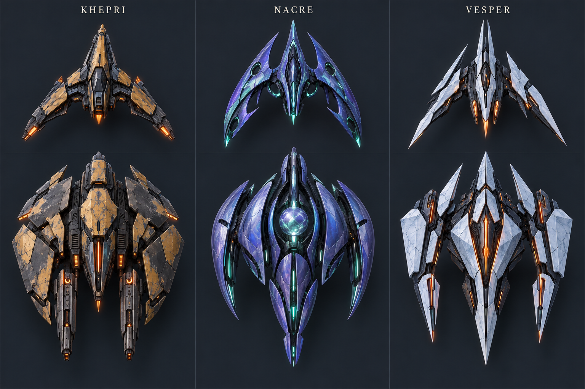
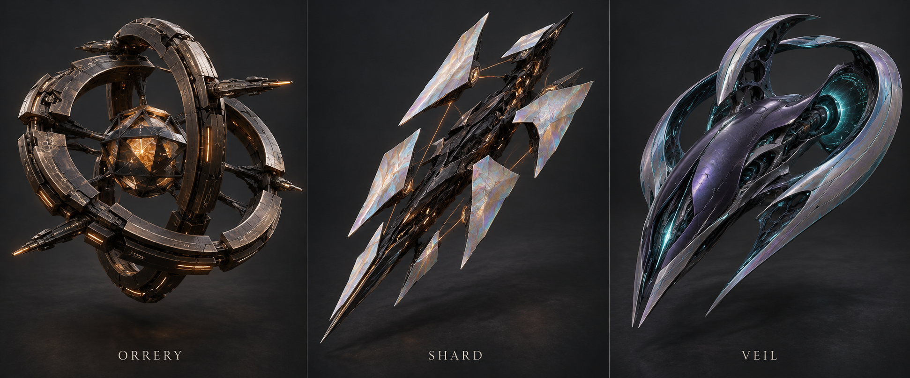
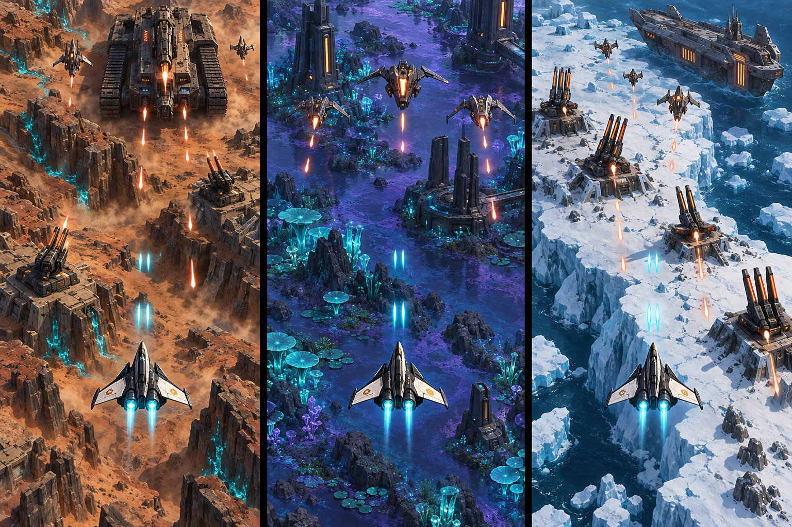

# Concept gallery

Design v0.2 · 13 October 2026. The latest hero and alien boards are accepted visual directions. No further regeneration is requested. All six images and their full prompts are saved here; concept renders are not screenshots or finished game assets.

## 1. Accepted hero tiers

[Image](04-hero-tiers.png) · [Full prompt](04-hero-tiers-prompt.txt)

**Scrapper** is the battered, inexpensive utility fighter. **Razor** is the slender interceptor. **Dominion** is the broad advanced assault craft. Preserve their fundamentally different silhouettes; progression must not look like adding armor to the same base ship.

The starter must be visibly smaller in the game. This board gives the designs similar presentation space for inspection, not a shared runtime scale. Proposed widths are 1.0 / 1.35 / 1.7 world units respectively, against a 12-unit-wide viewport. Use the same documented central collision radius and validate readability at phone size. Appearance is separate from equipment stats and campaign unlocks never improve endless starts.

## 2. Accepted alien faction craft

[Image](05-alien-factions.png) · [Full prompt](05-alien-factions-prompt.txt)

Use the six designs to establish each planet's faction materials and silhouettes. Assign each production craft a recognizable behavior archetype. Keep the most readable large forms; simplify surface detail and maintain consistent threat cues across variants.

## 3. Accepted exotic alien concepts

[Image](06-exotic-aliens.png) · [Full prompt](06-exotic-aliens-prompt.txt)

**Orrery:** interlocking rings around a core. **Shard:** asymmetric crystalline blades. **Veil:** flowing biomachine forms. These broaden the visual vocabulary without requiring new combat mechanics. Author readable silhouettes and central hit regions; decorative ring motion, fragments, and tendrils must not imply undocumented collision rules.

The concept count is not an obligation to build nine independent enemy systems in the MVP. Map selected silhouettes to the existing behavior catalog and stage additional models with the content milestones.

## 4. Current minimal HUD

[Image](03-minimal-hud.png) · [Full prompt](03-minimal-hud-prompt.txt)

Use the simple life silhouettes, shield glyphs, restrained score/pause readout, and flat bottom-center special button. Recharge belongs on that button. Steering uses invisible left/right screen halves. Gentle arrow hints appear only for the first three active seconds of a new flight; reduced-motion uses a temporary static hint.

This board establishes the HUD. Its earlier hero silhouette is superseded by the accepted hero board above. Build accessible UI in DOM/CSS and respect touch targets and phone safe areas rather than tracing the image. Campaign omits the permanent endless-score readout.

## 5. Three-world direction

[Image](01-worlds-direction.png) · [Full prompt](01-worlds-prompt.txt)

Left: Khepri's mineral badlands and tracked fortress. Middle: Nacre's luminous wetland and patrols. Right: Vesper's frozen coast and heavy machinery. Use the palettes, terrain forms, planetary variety, and ground-machine scale.

Simplify fine rubble, surface noise, dense plants, dust, and decorative emissive detail for gameplay. This reference is richer than the intended low-tier runtime scene. The hero design and apparent size here are historical; use the accepted tier board and written scale targets.

## 6. Historical v0.1 portrait reference

[Original portrait image](02-portrait-combat.png) · [Full prompt](02-portrait-prompt.txt)

Retained for design history only. Its resource bars, ornate special button, and placement are superseded by the minimal HUD above. Do not implement that earlier interface. Its fortress composition can still help discuss ground-target depth.

## Interpretation and production limits

- Written simulation rules determine hit regions, target acquisition, boss phases, and projectile spacing; image placement does not define them.
- Ground/boss target markers must follow current damageability and visibility. Concept art may show markers together for inspection.
- These are references for real 3D models and scenes, not static gameplay backgrounds.
- Production assets need optimized meshes, materials, sockets, animation, and a provenance manifest. No mobile performance is demonstrated by the images.
- Use procedural variations within approved shape families only. Author the hero chassis, enemy identities, and bosses.

Generation method: built-in imagegen. Each image's full prompt is linked above; prompts preserve the discussion but do not guarantee an identical regeneration. See [art and experience](../../docs/04-art-and-experience.md), [wide map and camera](../../docs/10-wide-map-and-camera.md), and the [consolidated design review](../../DESIGN-REVIEW.md).
